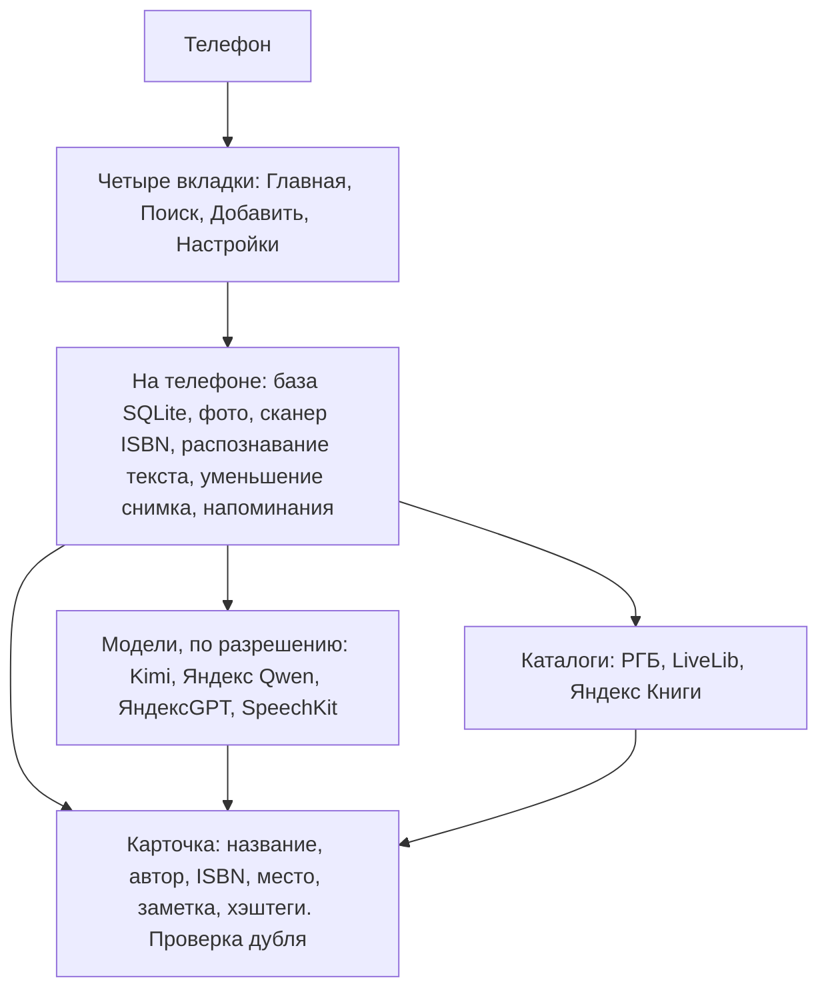
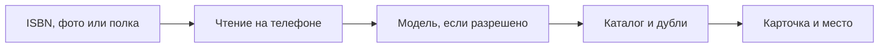
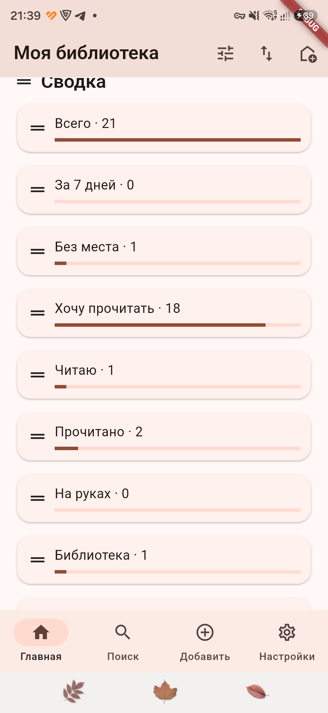
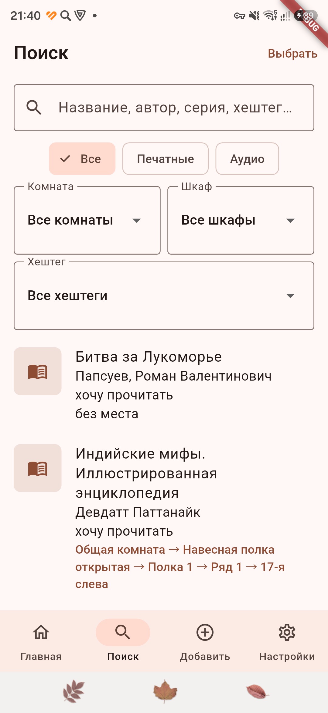
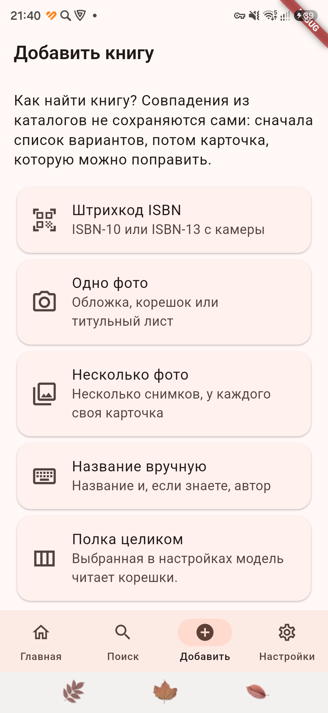
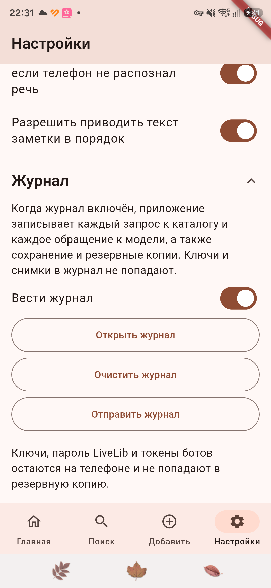
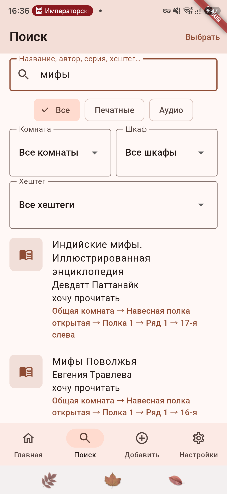
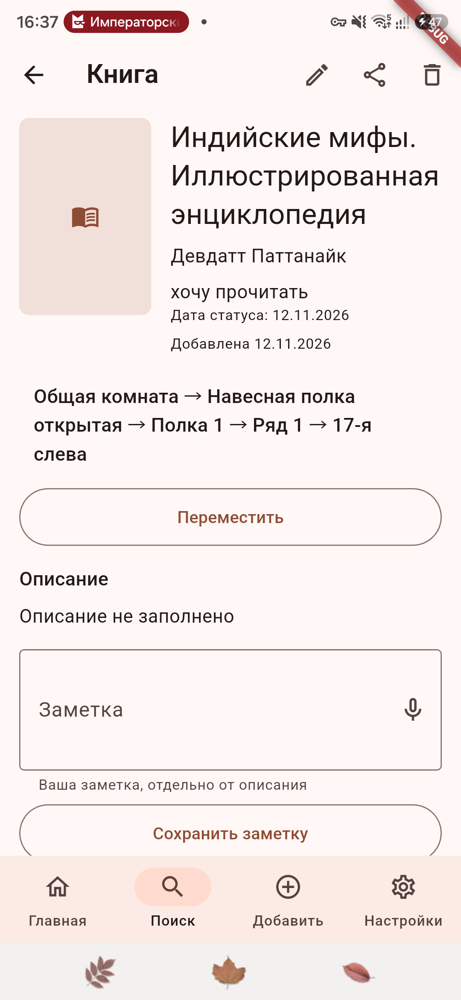
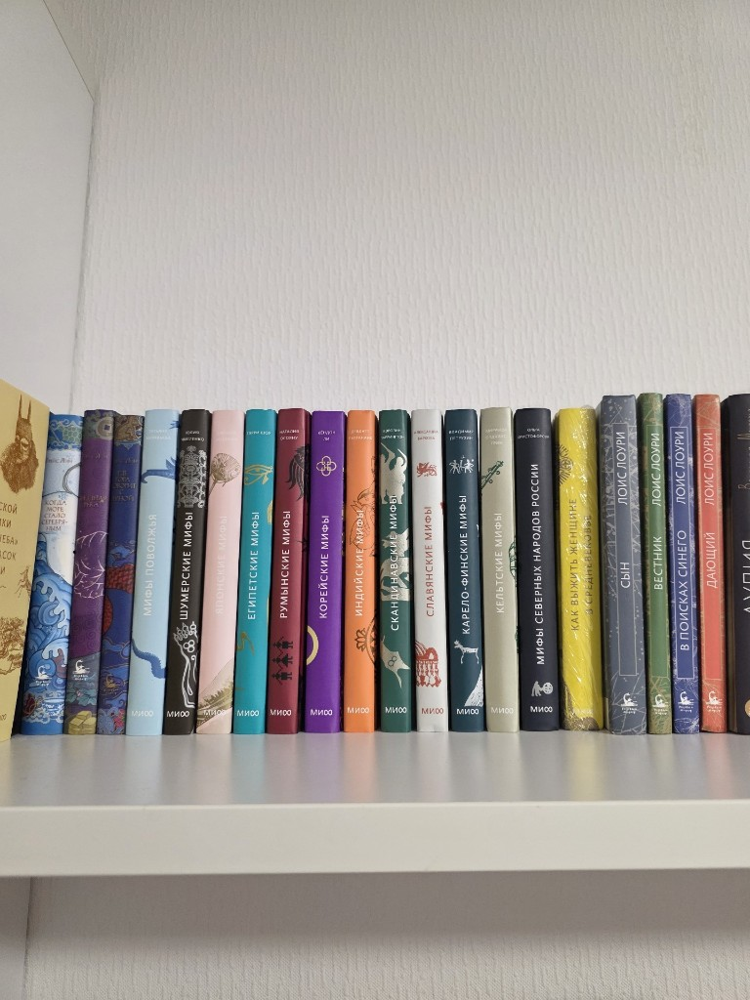
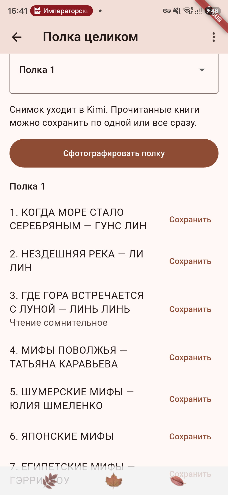

# Моя библиотека

Локальное приложение для телефона. Каталог бумажных книг живёт на устройстве: книгу можно найти по месту на полке и добавить по ISBN, фото или снимку полки целиком, не набирая каждый корешок руками.

## Для кого

Для человека, у которого дома уже много книг и который перестаёт помнить, в каком шкафу какая стоит. Отдельный случай — книга ушла в библиотеку или кому-то на руки, и о сроке легко забыть.

## Какую проблему закрывает

Ручной учёт слишком долгий, а фото полки само по себе не отвечает, где книга. Приложение превращает снимок, штрихкод или название в карточку с местом: комната, шкаф, полка, ряд.

## Что умеет

### Главная

- Комнаты, шкафы, полки и ряды.
- Сводка: всего, за неделю, без места, читаю, прочитано, на руках, просрочено, вернуть в библиотеку.
- Порядок блоков и комнат настраивается.

### Поиск

- По названию, автору, ISBN и хэштегу.
- Карточка открывается внутри вкладки «Поиск».

### Добавить

- Штрихкод ISBN, одно фото, несколько фото, название вручную.
- Полка целиком: модель читает корешки, к недоделанному снимку можно вернуться.
- Перед сохранением проверка, нет ли книги уже в базе.

### Карточка и настройки

- Место, заметка, хэштеги, выдача на руки, срок возврата в библиотеку.
- Ключи моделей вводятся в приложении и не лежат в исходниках.
- Резервная копия базы и фото. Журнал действий можно выключить.

## Как устроена работа

Книги, фото и структура шкафов остаются на телефоне. Снимок уходит в модель только после отдельного разрешения. Каталоги нужны, чтобы дополнить карточку, а не чтобы хранить библиотеку.

Данные библиотеки остаются на телефоне. Модели и каталоги только дополняют карточку.

## Как добавляется книга

Если с полки сохранены не все корешки, тот же снимок открывается снова. Повторно отправлять его в модель не нужно. Шаги мастера идут на весь экран, без нижней панели.

**Что остаётся локальным.** База, обложки, фото полок, недоделанный снимок полки, журнал. В резервную копию входят база и фото. Ключи и незаконченный снимок полки в архив не попадают.

**Что спрашивает разрешение.** Отправка фото полки в Kimi или Яндекс. Приведение голосовой заметки в порядок. Без разрешения корешки можно разметить чертами на самом телефоне.

## Основные окна

Снимки текущей сборки с телефона. Карточка книги открывается внутри той вкладки, откуда её вызвали.

| Главная | Поиск | Добавить |
| --- | --- | --- |
|  |  |  |

| Настройки | Поиск «мифы» | Карточка книги |
| --- | --- | --- |
|  |  |  |

Фото полки.

Полка целиком: прочитанные корешки можно сохранить по одному.
